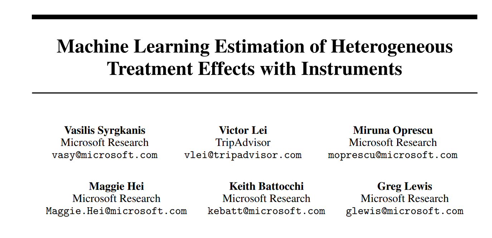
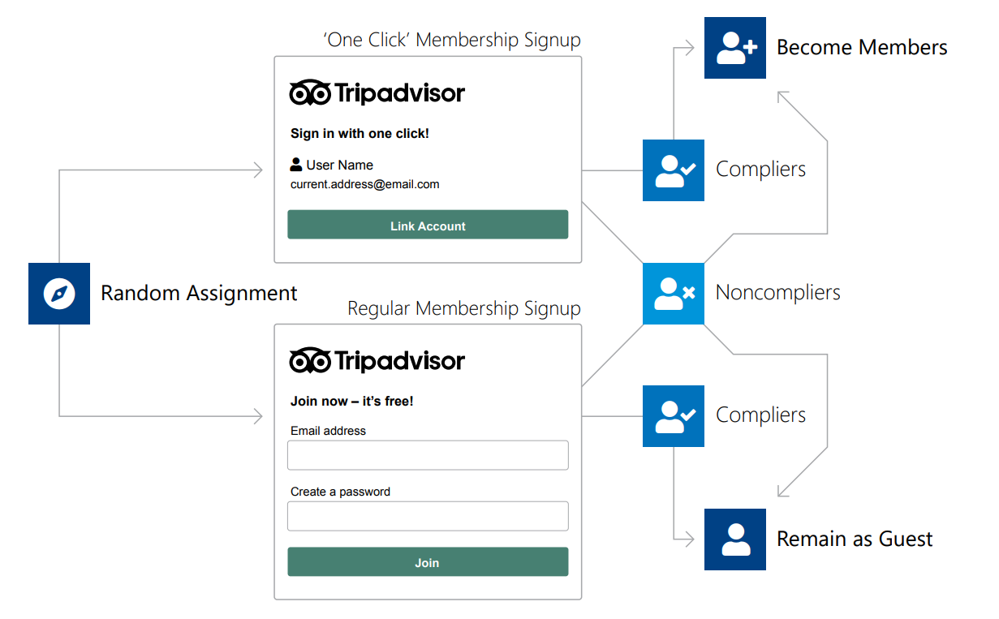
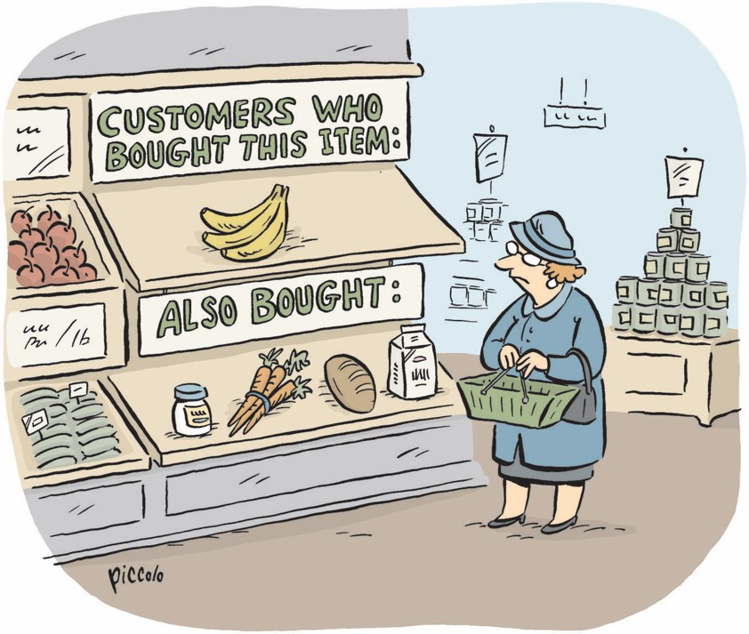

## Peut-on avoir le meilleur des deux mondes ?

::: columns
::: {.column width="45%"}
### Approche classique en économétrie

- Basée sur l’expertise du chercheur  
- Modèles simples, interprétables  
- Théoriquement fondée  
- Réflexion centrée sur la **causalité**  
- Un cadre propice à l’**inférence statistique** (tests, intervalles, etc.)
:::

::: {.column width="10%"}

:::

::: {.column width="45%"}
### Approche "data-driven" (ML)

- Compatible avec des **données riches**  
- Modèles **flexibles** et **performants**  
- Capable de découvrir des **relations nouvelles** entre variables  

:::
:::

## Limite 1 : non-linéarité

```{r}
#| echo: true
#| code-fold: true
#| code-summary: "Code"
library(plotly)

set.seed(123)
x <- seq(0, 10, length.out = 100)
y <- sin(x) + 1 + rnorm(100, sd = 0.2)

modele_lin <- lm(y ~ x)
y_pred <- predict(modele_lin)

fig <- plot_ly()

# 1. Points de données (bleu - colorblind safe)
fig <- fig %>%
  add_trace(
    x = ~x, y = ~y,
    type = 'scatter', mode = 'markers',
    name = "Données",
    marker = list(color = '#0072B2'),
    hoverinfo = 'x+y'
  )

# 2. Droite de régression (orange - masquée au départ)
fig <- fig %>%
  add_trace(
    x = ~x, y = ~y_pred,
    type = 'scatter', mode = 'lines',
    name = "Régression linéaire",
    visible = "legendonly",
    line = list(color = '#D55E00', width = 2)
  )

# 3. Mise en page
fig <- fig %>%
  layout(
    title = list(text = "Exemple de relation non linéaire : y ~ sin(x) + 1"),
    xaxis = list(title = "x"),
    yaxis = list(title = "y"),
    legend = list(x = 1, y = 0, xanchor = "right", yanchor = "bottom"),
    plot_bgcolor = 'rgba(0,0,0,0)',  # fond transparent
    paper_bgcolor = 'rgba(0,0,0,0)'
  ) %>%
  config(displayModeBar = FALSE, displaylogo = FALSE)

fig

```

## Limite 2 : interactions
```{r}
#| echo: true
#| code-fold: true
#| code-summary: "Code"
library(plotly)

# 1. Données simulées
set.seed(42)
n <- 100
x1 <- runif(n, -2, 2)
x2 <- runif(n, -2, 2)
y <- 1 + 2*x1 + 3*x2 + 4*x1*x2 + rnorm(n, 0, 1)
df <- data.frame(x1 = x1, x2 = x2, y = y)

# 2. Modèles
mod_no_inter <- lm(y ~ x1 + x2, data = df)
mod_inter <- lm(y ~ x1 * x2, data = df)

# 3. Grille pour prédictions
x1_grid <- seq(-2, 2, length.out = 50)
x2_grid <- seq(-2, 2, length.out = 50)
grid <- expand.grid(x1 = x1_grid, x2 = x2_grid)
grid$y_no_inter <- predict(mod_no_inter, newdata = grid)
grid$y_with_inter <- predict(mod_inter, newdata = grid)

# 4. Matrices pour surfaces
z1_matrix <- matrix(grid$y_no_inter, nrow = length(x1_grid), byrow = FALSE)
z2_matrix <- matrix(grid$y_with_inter, nrow = length(x1_grid), byrow = FALSE)

# 5. Création du graphique
fig <- plot_ly()

# Points simulés
fig <- fig %>%
  add_markers(data = df, x = ~x1, y = ~x2, z = ~y,
              marker = list(size = 3, color = 'black'),
              name = "Points simulés",
              visible = TRUE)

# Surface sans interaction (orange - masqué)
fig <- fig %>%
  add_surface(x = ~x1_grid, y = ~x2_grid, z = ~z1_matrix,
              opacity = 0.6,
              colorscale = list(c(0, '#E69F00'), c(1, '#E69F00')),
              name = "Modèle sans interaction",
              showscale = FALSE,
              visible = FALSE)

# Surface avec interaction (bleu - masqué)
fig <- fig %>%
  add_surface(x = ~x1_grid, y = ~x2_grid, z = ~z2_matrix,
              opacity = 0.6,
              colorscale = list(c(0, '#0072B2'), c(1, '#0072B2')),
              name = "Modèle avec interaction",
              showscale = FALSE,
              visible = FALSE)

# 6. Menu interactif
fig <- fig %>%
    layout(
    title = "Comparaison : Modèles avec et sans interaction",
    scene = list(
        xaxis = list(title = "x1"),
        yaxis = list(title = "x2"),
        zaxis = list(title = "y")
    ),
    legend = list(x = 1, y = 0, xanchor = "right", yanchor = "bottom"),
    plot_bgcolor = 'rgba(0,0,0,0)',
    paper_bgcolor = 'rgba(0,0,0,0)',
    updatemenus = list(
        list(
        type = "buttons",
        direction = "down",
        xanchor = "left",
        yanchor = "bottom",
        x = 0.05,
        y = 0.05,
        showactive = TRUE,
        buttons = list(
            list(label = "Points seulement",
                method = "update",
                args = list(list(visible = list(TRUE, FALSE, FALSE)))),
            list(label = "Points + sans interaction",
                method = "update",
                args = list(list(visible = list(TRUE, TRUE, FALSE)))),
            list(label = "Points + avec interaction",
                method = "update",
                args = list(list(visible = list(TRUE, FALSE, TRUE))))
        )
        )
    )
    ) %>%
  config(displayModeBar = FALSE, displaylogo = FALSE)

fig
```

## Limite 3 : le problème de la grande dimension

::: columns
::: {.column width="50%"}
```{r}
#| echo: true
#| code-fold: false
set.seed(123)
n <- 50

x1 <- rnorm(n)
y <- 2 * x1 + rnorm(n)

df_small <- data.frame(x1 = x1, y = y)
formule <- as.formula(paste("y ~ x1"))
```

:::

::: {.column width="50%"}
```{r}
summary(lm(formule, data = df_small))
```
:::

:::

## Limite 3 : le problème de la grande dimension

::: columns
::: {.column width="50%"}
```{r}
#| echo: true
#| code-fold: false
set.seed(123)
n <- 50
k <- 25

x1 <- rnorm(n)
y <- 2 * x1 + rnorm(n)
X_noise <- replicate(k - 1, rnorm(n))
colnames(X_noise) <- paste0("x", 2:k)

df_too_wide <- data.frame(x1 = x1, X_noise, y = y)
formule <- as.formula(paste("y ~", paste0("x", 1:k, collapse = " + ")))
```
::: 

::: {.column width="50%"}
```{r}
summary(lm(formule, data = df_too_wide))
```
:::

:::

## Limite 3 : le problème de la grande dimension

::: columns
::: {.column width="50%"}
```{r}
#| echo: true
#| code-fold: false
set.seed(123)
n <- 50
k <- 100  # Plus de variables que d'observations

x1 <- rnorm(n)
y <- 2 * x1 + rnorm(n)
X_noise <- replicate(k - 1, rnorm(n))
colnames(X_noise) <- paste0("x", 2:k)

df_too_wide <- data.frame(x1 = x1, X_noise, y = y)
formule <- as.formula(paste("y ~", paste0("x", 1:k, collapse = " + ")))
```
:::

::: {.column width="50%"}
```{r}
summary(lm(formule, data = df_too_wide))
```
:::

:::

## Pourquoi c'est important en sciences sociales ?

Des cas déjà connus :

1. Non-linéarité : l'expérience et le carré de l'expérience pour expliquer le salaire
2. Interactions : entre sources de discrimination
3. Grande dimension :
    - Big Data en ligne
    - Transformations des variables explicatives : expansions polynomiales, interactions...

Des cas sans doute encore inconnus !

## Machine Learning supervisé

Formulons le problème de manière générale :

$$
\underset{m}{\operatorname{Minimiser}} \sum_{i=1}^n \underbrace{\mathcal{L}\left(y_i, m\left(X_i\right)\right)}_{\text {fonction de perte }}+\underbrace{\lambda\|m\|_{\ell_q}}_{\text {pénalité }}
$$

- Choix de la fonction de perte:
  - $\mathcal{L} \rightarrow$ peut être la somme des carrés des résidus par exemple
  - $m \rightarrow$ différent selon l'algorithme, par exemple $m(X_i) = X_i\beta$
- Choix de la pénalité
  - $\ell_q \rightarrow$ lasso ($\ell_1$), ridge ($\ell_2$)
  - $\lambda \rightarrow$ paramètre souvent estimé par validation croisée

## La méthode du lasso, une alternative ?

::: columns
::: {.column width="50%"}
```{r}
#| echo: true
#| code-fold: false
library(glmnet)
set.seed(123)
n <- 50
k <- 100  # Plus de variables que d'observations

x1 <- rnorm(n)
y <- 2 * x1 + rnorm(n)
X_noise <- replicate(k - 1, rnorm(n))
colnames(X_noise) <- paste0("x", 2:k)
df_too_wide <- data.frame(x1 = x1, X_noise)
X <- as.matrix(df_too_wide)

lasso_model <- glmnet(X, y, alpha = 1)
cv_model <- cv.glmnet(X, y, alpha = 1)
```
:::

::: {.column width="50%"}
```{r}
coef(cv_model, s = "lambda.min")
```
:::

:::

## La méthode du OLS Post-Lasso pour faire de l'inférence ?

::: columns
::: {.column width="50%"}
```{r}
#| echo: true
#| code-fold: false
coef_lasso <- coef(cv_model, s = "lambda.min")
selected <- which(coef_lasso[-1, 1] != 0)  # enlever l’intercept
selected_vars <- colnames(X)[selected]

df_selected <- data.frame(y = y, X[, selected_vars, drop = FALSE])
post_lasso_model <- lm(y ~ ., data = df_selected)
```

:::{.smaller-code}

Ici la sélection imparfaite du modèle ne biaise pas le coefficient devant `x1`, car les variables non sélectionnées ne sont pas corrélées à `y`.

:::

::: 
::: {.column width="50%"}
```{r}
summary(post_lasso_model)
```
:::
:::

. . .


:::{.smaller-code}
> *Une sélection de modèle parfaite repose sur des hypothèses extrêmement irréalistes, et même des erreurs modérées dans le choix du modèle peuvent avoir de graves conséquences sur l'inférence, comme cela a été démontré dans @potscher2009confidence, @leeb2008can, et d'autres travaux.* [@belloni2014inference] (traduit de l'anglais)
>
:::


## Post-double-selection procedure

@belloni2014inference

::: columns
::: {.column width="50%"}
```{r}
#| echo: true
#| code-fold: false

# Split échantillon : moitié pour lasso, moitié pour OLS
set.seed(42)
idx <- sample(1:n, n/2)
X_train <- X[idx, ]
X_test <- X[-idx, ]
y_train <- y[idx]
y_test <- y[-idx]

# lasso 1 (y ~ X, sans x1) sur le train
cv_model_y <- cv.glmnet(X_train[, -1], y_train, alpha = 1)
coef_y <- coef(cv_model_y, s = "lambda.min")
selected_y <- which(coef_y[-1, 1] != 0)
selected_vars_y <- colnames(X[, -1])[selected_y]

# lasso 2 (x1 ~ X, sans x1) sur le train
x1_train <- X_train[, 1]
cv_model_x1 <- cv.glmnet(X_train[, -1], x1_train, alpha = 1)
coef_x1 <- coef(cv_model_x1, s = "lambda.min")
selected_x1 <- which(coef_x1[-1, 1] != 0)
selected_vars_x1 <- colnames(X[, -1])[selected_x1]

# Union des variables sélectionnées
selected_controls <- union(selected_vars_y, selected_vars_x1)

# Créer un df test pour OLS post-double-lasso
x1_test <- X_test[, 1]
controls_test <- as.data.frame(X_test[, selected_controls, drop = FALSE])
df_ols <- data.frame(y = y_test, x1 = x1_test, controls_test)

# Régression OLS post-double-lasso sur le test set
model_split <- lm(y ~ ., data = df_ols)
```
:::
::: {.column width="50%"}
```{r}
summary(model_split)
```
:::
:::

## En Résumé

:::{.incremental}
- On a vu une extension naturelle du modèle linéaire estimée par MCO : le lasso
- Le lasso permet de sélectionner des variables
- Néanmoins, les méthodes d'inférence causale ne sont pas si facilement applicables
- En fait, un champ spécifique s'est développé pour apprendre à combiner approche ML et économétrie : le **machine learning causal**
- De nombreuses extensions en dehors du cadre linéaire
:::


## Étude de cas : Microsoft, économie, stats et informatique


:::: {.columns}

::: {.column width="70%"}
- On voit des interactions entre l'industrie et la recherche sur ces thématiques
- Exemple : **Susan Athey**, économiste renommée
  - A travaillé 6 ans comme *consulting chief economist* chez Microsoft
  - Encourage les économistes à s’intéresser au machine learning, et vice versa
- Microsoft investit dans la recherche : **ALICE**, **DoWhy** par exemple
:::
::: {.column width="30%"}

:::
:::
## Un module Python econml

```{=html}
<iframe width="780" height="500" src="https://econml.azurewebsites.net/" title="Webpage example"></iframe>
```


---

## Une application concrète



---

## Contexte économique

- TripAdvisor : réservation de voyages, hôtels, restaurants
- Objectif : mesurer l’effet de la création d’un **compte membre** sur les **réservations**

:::{.callout-tip}
## Que pensez-vous des stratégies suivantes ?

:::{.incremental}
- **Proposition 1 :** Comparer les réservations des membres vs. non-membres  
- **Proposition 2 :** Forcer ou empêcher la création de compte par tirage aléatoire  
- **Proposition 3 :** Randomiser une **incitation** à créer un compte  
:::
:::


## Design expérimental



---

## Méthode économétrique utilisée

- Approche classique : **variables instrumentales (IV)**
- Données TripAdvisor : 
  - 4 606 041 utilisateurs
  - Réalisation d'une expansion des variables + interactions complexes
- Solution : méthode de @syrgkanis2019machine combinant méthodes à variables instrumentales (économétrie classique) + ML

---

## Recommandations politiques

Les personnes qu'il faut cibler en priorité d'après l'analyse :

- Les **utilisateurs d'iPhone**
- Les utilisateurs **qui fréquentent déjà les pages de location**
- Les utilisateurs qui ont fait **récemment une réservation**
- Les utilisateurs qui **visitaient déjà souvent le site**

---

## ML / IA : une révolution pour la décision ?

:::{.incremental}

- Avancées majeures dans la **modélisation prédictive**
- Adaptation des modèles au contexte de la prise de décision
- Mais : résultats ici **pas révolutionnaires**
  - On s’attendait à ce que fidéliser les bons clients soit efficace
- Intérêt :
  - Déterminer les **seuils précis** à partir desquels l’effet devient très important pour savoir sur qui concentrer les efforts
  - Méthode flexible
- Résultats sobre mais ⚠️ contexte d'un papier de recherche : **objectif = valider la méthode** (preuve de concept)
:::


## Des débats animés

::: columns
::: {.column width="60%"}

:::{.incremental}
- Espoirs : 
  - Modèles plus performants 
  - Applications en médecine, en évaluation des politiques publiques

- Inutilité/gadget :
  - Rien de plus que des statistiques ?
  - Beaucoup d'erreurs dans les modèles de prédiction
  - Technosolutionnisme

- Dangerosité/menace :
  - Protection des données, surveillance
  - Biais discriminatoires
  - Absence de transparence
  - Enjeux environnementaux

:::

:::
::: {.column width="40%"}

:::
:::

## Quelle approche à l'Ensai ?

:::{.incremental}

- Côté enseignement, on met l'accent sur les fondamentaux en économie, informatique, statistique

- Côté recherche :
  - Production de travaux dans ces disciplines
  - Suivi des avancées en analyse de données

- Objectifs : 
  - Permettre aux étudiants de comprendre les enjeux liés à la valorisation économique des grandes bases de données
  - Former des ingénieurs avec des compétences techniques solides pour comprendre les enjeux de demain liés à l'usage des modèles prédictifs et des IA

:::


. . .

<br>

:::{.center}
Merci pour votre attention !
:::

---
